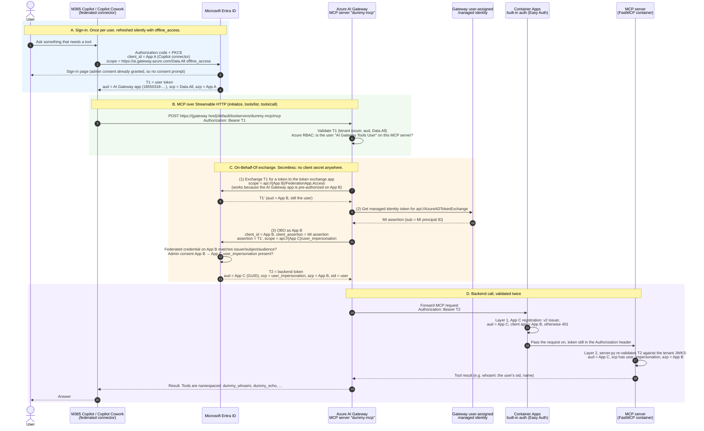
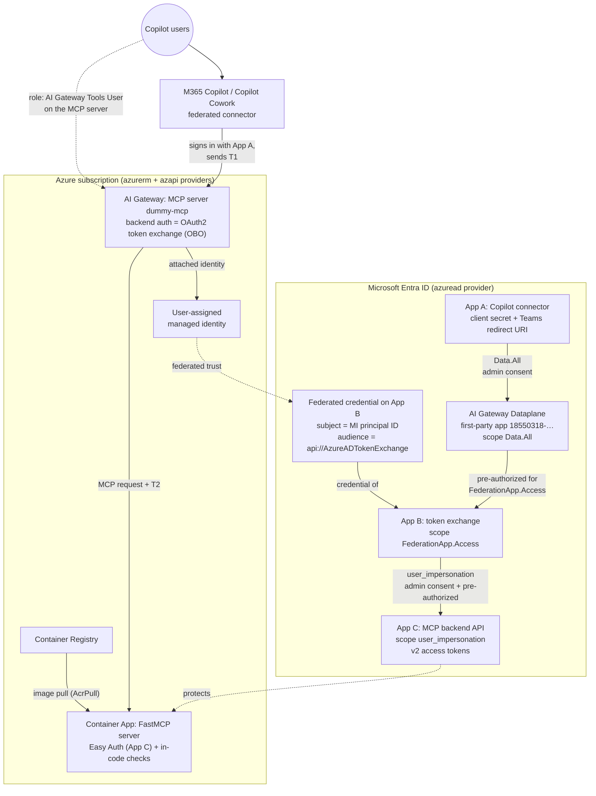

# Flow: Microsoft 365 Copilot / Copilot Cowork → Azure AI Gateway → MCP server (as the user)

The user signs in once in Copilot. Every tool call then reaches the MCP backend with a token
that carries **the user's identity** but was issued **for the backend** and requested **by the
gateway's token exchange app**. No secrets sit in the gateway: it authenticates as the token
exchange app with its user-assigned managed identity (workload identity federation).

## 1. Runtime sequence (one tool call)

Step C(1) happens inside the gateway and isn't observable from outside. It's the hop implied by
the required configuration: the gateway's first-party app must be pre-authorized for
`FederationApp.Access` on the token exchange app. Everything else was verified end to end with
`scripts/test-obo.py`. The backend received the caller's `oid`, with `aud` = App C and
`azp` = App B.

## 2. Tokens along the way

| Token | Issued to (azp) | Audience (aud) | Scope (scp) | Identity | Who validates it |
| --- | --- | --- | --- | --- | --- |
| **T1** | App A (Copilot connector) | `18550318-e177-4205-a743-6816d6fcdc3f` (AI Gateway) | `Data.All` | user | AI Gateway, then Azure RBAC |
| **T1'** | AI Gateway app | App B (token exchange) | `FederationApp.Access` | user | Entra (OBO input) |
| MI assertion | Gateway managed identity | `api://AzureADTokenExchange` | n/a | managed identity | Entra (federated credential on App B) |
| **T2** | App B (token exchange) | App C client ID (v2 tokens use the bare GUID) | `user_impersonation` | user | Easy Auth, then `server.py` |

## 3. Trust relationships created by Terraform

## 4. Why each piece exists

| Piece | Without it |
| --- | --- |
| AI Gateway Dataplane service principal in the tenant | No tenant can issue `Data.All` tokens; Copilot sign-in fails. |
| App A delegated `Data.All` + admin consent | Users get consent prompts, or a "needs admin approval" block, in Copilot. |
| Runtime role **AI Gateway Tools User** | Gateway returns 403. Owner and Contributor do not grant tool invocation. |
| Pre-authorization of `18550318-…` on App B | The gateway can't obtain T1', so OBO fails. |
| Federated credential (subject = MI **principal** ID) | App B can't authenticate; OBO fails. |
| Toolserver `appCredential.clientId` = MI **client** ID | The gateway picks the wrong identity. |
| App B → App C admin consent | OBO fails with a consent error (`AADSTS65001`), and the gateway returns 401. |
| Explicit backend scope (not `/.default`) | The gateway rejects the configuration. |
| App C `requested_access_token_version = 2` | T2 is a v1 token (`sts.windows.net` issuer, `api://` audience), so the backend rejects it. |
| Container Apps Easy Auth with App C | Invalid tokens would reach the container, leaving the in-code checks as the only gate. |
| Backend `azp` allow-list (Easy Auth `allowedApplications` + code) | Any app with a consented token for App C could call the backend directly. |
| Gateway MCP versions ⊆ backend versions | M365 Copilot proposes `2025-11-25`; mismatches show up as 502 or `-32603` on `tools/list`. |
